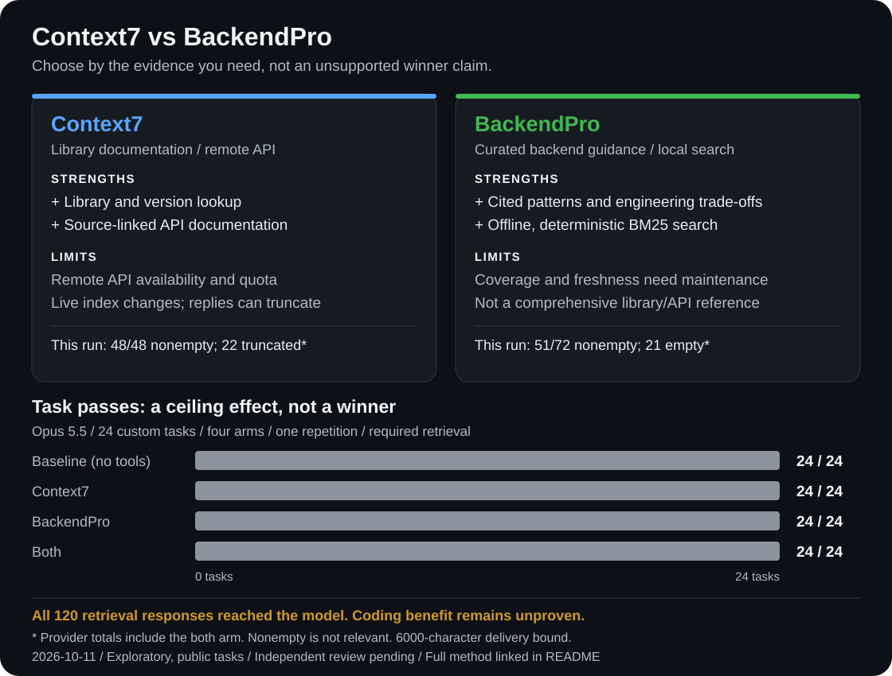
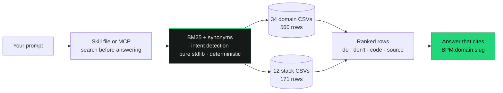

<div align="center">


<br />

[](https://pypi.org/project/backendpro/)
[](https://github.com/shashankswe2020-ux/backend-pro-max-skill/actions/workflows/ci.yml)
[](#why-you-can-trust-it)
[](#mcp-server)
[](#quick-start)
[](#quick-start)
[](LICENSE)

**[Walkthrough](#watch-the-walkthrough)** ·
**[Quick start](#quick-start)** ·
**[Your agent](#plug-it-into-your-agent)** ·
**[Commands](#commands)** ·
**[MCP](#mcp-server)** ·
**[Context7 comparison](#context7-vs-backendpro)** ·
**[Domains](#domains-and-stacks)** ·
**[backendpro.cc](https://backendpro.cc)**

</div>

---

Your AI coding assistant knows *about* Kafka, retries and sagas. It doesn't know which one fits your system or why, and it never tells you where its advice came from.

**Backend Pro Max** is a curated knowledge base of backend and distributed-systems rules. Every rule is one structured row with *when to use it*, *when not to*, trade-offs, good vs bad code, and a source URL. Your agent searches it before answering, using a pure-Python BM25 engine that's offline and deterministic, and cites the row it used: `[BPM:reliability.resilience]`.

It works with Claude Code, Cursor, Windsurf, GitHub Copilot, Continue and Gemini, and with any MCP client.

## Watch the walkthrough

<div align="center">

<a href="https://youtu.be/UdzSAJJlM3w?si=eWOuRJXVVnDZSAU4">
  
</a>

**[▶ I gave my AI a staff engineer's brain](https://youtu.be/UdzSAJJlM3w?si=eWOuRJXVVnDZSAU4)**: an 18-minute tour of every feature. We design a payments service end to end with retries, a saga, idempotency keys, an outbox, a broker ADR and capacity maths, all of it cited. Every terminal shot is real CLI output, and both Claude sessions are real MCP calls.

</div>

## Same prompt. Different reviewer.

<div align="center">

</div>

> *"Add retries to our outbound payments HTTP client. Python + FastAPI."*
>
> **Left:** from memory. It retries every error, including 4xx, with no jitter and no idempotency key.
> **Right:** the same model with `backendpro-mcp`. It searches `reliability` and `python-fastapi` first, then answers with retryable-status gating, full jitter, an `Idempotency-Key`, explicit timeouts, and a link to the AWS Builders' Library article each rule came from.

---

## Context7 vs BackendPro

**Different sources, different trade-offs—not a proven winner.** Context7 retrieves
library/API documentation; BackendPro searches curated backend patterns, operational
guidance and stack-specific rules locally.



| | Context7 | BackendPro |
|---|---|---|
| Useful when | You need library/API usage and version-specific documentation | You need backend patterns, failure modes and engineering trade-offs |
| Strengths | Library/version lookup; source-linked documentation snippets | Offline, deterministic BM25 search; cited rules and explicit do/don't guidance |
| Limits | Remote API availability and quota; live index changes; bounded replies can truncate evidence | Curated coverage and freshness need maintenance; not a comprehensive API reference |
| In this live run, across both arms using each tool | 48/48 calls returned evidence; 22 replies were truncated | 51/72 calls returned evidence; 21 returned no matches |

**What we measured:** on 2026-10-11, Opus 5.5 completed a custom 24-task Python
suite across baseline, Context7, BackendPro and both, with one repetition and
required retrieval. Every arm scored **24/24**. All **120 retrieval responses**
reached the model; the total API cost upper bound was **$2.91**, including probes.

**What we did not prove:** the no-tool baseline also passed everything—a ceiling
effect. This exploratory, independently unreviewed run demonstrates neither a
coding benefit nor equivalence. Nonempty evidence is not a relevance score, and
using both tools has not been shown to improve outcomes.

Use the source that fits the task; verify retrieved guidance against your version
and deployment. Read the [full report and machine-readable results](benchmarks/m3/results/2026-10-11/README.md)
for per-arm costs, latency, methodology and limitations. The earlier
[SWE-bench pilot](benchmarks/swebench-pilot/comparison-results.md) invoked neither
knowledge tool, so its scores cannot rank retrieval quality.
Context7's capabilities and quotas are documented in its
[API guide](https://context7.com/docs/api-guide) and [plans](https://context7.com/plans).

## Quick start

```bash
pip install backendpro                    # pure stdlib, no models, no network

backendpro "retry backoff jitter" --domain reliability
backendpro "virtual threads" --stack java-spring
backendpro "idempotency" --all            # every domain at once
backendpro --list                         # 34 domains, 12 stacks
```

That first query returns a real, ranked, sourced row:

```text
### Result 1  [BPM:reliability.resilience]  _(rank score: 14.89)_
- Topic:        Retries with backoff + budget
- Failure Mode: Naive retries cause thundering herd; non-idempotent retries cause duplicates
- Mitigation:   Exponential backoff + jitter; cap attempts; total retry budget per call
- Do:           Retry only idempotent calls; carry idempotency keys
- Don't:        Retry every error
- Metric:       Retry rate, retry success rate
- Source URL:   https://aws.amazon.com/builders-library/timeouts-retries-and-backoff-with-jitter/
- Last Updated: 2026-04-28
```

> `pipx install backendpro` works too. Without installing: `python3 src/backend-pro-max/scripts/search.py "<query>"`.

## Plug it into your agent

One command writes the skill file. The file tells your agent to **search first, cite the row, and prefer stack guidelines for code**.

| Agent | Command | Writes |
|---|---|---|
| **Claude Code** | `backendpro --load claude` | `.claude/skills/backend-pro-max/SKILL.md` |
| **Cursor** | `backendpro --load cursor` | `.cursor/rules/backend.mdc` |
| **Windsurf** | `backendpro --load windsurf` | `.windsurfrules` |
| **GitHub Copilot** | `backendpro --load copilot` | `.github/copilot-instructions.md` |
| **Continue** | `backendpro --load continue` | `AGENTS.md` |
| **Gemini Code Assist** | copy `templates/base/skill-content.md` | `GEMINI.md` |
| **Claude Desktop, Cline, Zed, any MCP client** | `pip install 'backendpro[mcp]'` | see [MCP server](#mcp-server) |

<details>
<summary>Gemini: copy the skill file from the installed package</summary>

```bash
cp "$(python3 -c "import backendpro as b; print(b.__path__[0])")/templates/base/skill-content.md" GEMINI.md
```
</details>

---

## Commands

| What you want | Command |
|---|---|
| Search, with the domain auto-detected | `backendpro "kafka exactly once delivery"` |
| Search one domain or stack | `backendpro "circuit breaker" --domain pattern` · `--stack rust-axum` |
| Side-by-side table for an ADR | `backendpro compare "Apache Kafka" "RabbitMQ" --domain messaging` |
| Ranked recommendation under constraints | `backendpro "Kafka vs Pulsar vs Pub/Sub on GCP with ordering" --decide` |
| Architecture Decision Record (Nygard format) | `backendpro "Redis vs Memcached for session cache" --adr "Session cache store" --domain cache --out docs/adr/0007.md` |
| System-design scaffold with capacity maths | `backendpro "Postgres for 50M DAU e-commerce" --design` |
| Back-of-envelope numbers | `backendpro calc qps --daily 50000000` (also `storage`, `bandwidth`, `cache-hit`, `concurrency`, `fanout`, `partitions`) |
| Architectural tensions between rules | `backendpro conflicts --domain cache` |
| Interactive design session | `backendpro --interactive` (`/d` `/s` `/all` `/cmp` `/stale`) |
| JSON / JSONL for agents | `backendpro "redis cluster" --json` · `--jsonl` |

<details>
<summary><strong>Useful flags</strong></summary>

| Flag | Effect |
|---|---|
| `-n N` | Max results per scope (default 5; `--all` defaults to 2 per domain) |
| `--min-score F` | Drop weak matches |
| `--no-expand` | Turn off synonym expansion (`partial failure` → saga, compensation…) |
| `--intent troubleshoot` | Force the answer template (`definition`, `comparison`, `troubleshoot`, `design`, `migration`, `incident`) |
| `--max-age-months N` | Drop rows older than N months |
| `--show-provenance` | Show the `Added By` and `Version` columns |
| `--engine hybrid` | BM25 + embeddings (`pip install 'backendpro[semantic]'`) |
| `--rerank` | Cross-encoder ranking before final top-N selection (`pip install 'backendpro[rerank]'`) |
| `--candidate-pool 20` | Candidates per scope before final selection; at least `-n` |
| `--diagnostics` | Requested/effective engine, fallbacks, candidate counts, and auto-scope hints |
| `--evidence` | Opt-in version-aware whole-unit evidence selection; legacy formats unchanged |
| `--library-version pydantic=2.10.6` | Explicit release observation for evidence output |
| `--project-path PATH` | Opt-in local Python manifest/lock inspection, never uploaded |
| `--max-chars N` | Evidence JSON budget (default 6000 characters including metadata) |
| `--evidence-id ID` | Expand a returned stable content ID to its full local source row |

</details>

CLI and MCP searches share the same optional retrieval pipeline. BM25 remains
the offline, zero-dependency default. Reranking defaults to at least 20 candidates;
`--all -n N` now means exactly N per domain, matching MCP `max_results`.
Explicit domains/stacks are never widened. Missing optional dependencies are
reported as fallbacks; model execution errors are surfaced, not hidden.
Rank scores are not confidence or correctness probabilities.
See [retrieval options and compatibility notes](docs/USAGE.md#retrieval-pipeline-and-diagnostics).
The opt-in [P2 evidence format](docs/USAGE.md#version-aware-budget-aware-evidence-p2-opt-in)
adds a pinned-source Pydantic v1/v2 pilot, explicit unknown/conflicting version
states, complementary evidence selection and omission accounting. It does not
establish independently reviewed applicability or coding-outcome gains.

For [local repository grounding](docs/USAGE.md#repository-grounding-p3-opt-in),
use explicit file scopes:

```bash
backendpro context "retry" --workspace-root /path/to/git/repo \
  --paths src/retry.py tests/test_retry.py --max-chars 6000
```

The Python/POSIX pilot prefers saved-file editor locations when supplied and
otherwise uses bounded AST/text extraction. References carry Git revisions,
file hashes and line ranges; stale inputs fail explicitly. Local and curated
guidance stay distinguishable. No code execution, network or persistent index
is involved. MCP requires operator-set `BACKENDPRO_WORKSPACE` and is disabled
for repository reads by default.

### Decisions, not just search

`--decide` pulls constraints out of your sentence, searches across domains, and ranks candidates by how well they fit. It isn't limited to the options you named. Real output:

<details>
<summary><strong>"Postgres vs DynamoDB for 50M DAU e-commerce with strong consistency on multi-cloud"</strong>: recommends neither</summary>

```text
### Extracted Constraints
- cloud: multi-cloud
- consistency: strong

### 🏆 Recommendation: CockroachDB (database)
- ✅ cloud: wanted multi-cloud, got multi
- ✅ consistency: wanted strong, got strong

| # | Name                         | Domain      | Score | Constraints |
| 1 | CockroachDB                  | database    | 4.61  | 2/2 |
| 2 | etcd / ZooKeeper / Consul    | database    | 4.12  | 2/2 |
| 3 | PostgreSQL                   | database    | 5.48  | 1/2 |
| 4 | Spanner / TiDB               | database    | 4.36  | 1/2 |
| 5 | Quorum reads/writes (R+W>N)  | consistency | 8.31  | 0/2 |
```
Both named options miss a constraint, so the tool brings up the database a reviewer would ask about. It ranks on constraint fit first, so treat the list as a shortlist to read rather than a verdict. etcd at #2 is a coordination store, not an order database.
</details>

<details>
<summary><strong>"monolith vs microservices for a 10-person startup"</strong>: commits to an answer</summary>

```text
### 🏆 Recommendation: Modular Monolith (architecture)

| # | Name                          | Score |
| 1 | Modular Monolith              | 4.52  |
| 2 | Monolith                      | 2.67  |
| 3 | BFF (Backend for Frontend)    | 2.54  |
| 4 | Microservices                 | 1.82  |
| 5 | Service Mesh + Microservices  | 1.66  |

Modular Monolith:
- ✅ Strong domain boundaries inside one process; can split later
- ⚠️ Discipline required to avoid 'big ball of mud'
```
</details>

---

## MCP server

```bash
pip install 'backendpro[mcp]'     # quotes needed in zsh; the core package stays dependency-free
backendpro-mcp                    # stdio transport
```

<div align="center">

<sub>A real session against <code>backendpro-mcp</code>: five tool calls, then a payments-service design where every point carries a <code>[BPM:…]</code> citation.</sub>
</div>

<br />

**Claude Desktop:** add this to `~/Library/Application Support/Claude/claude_desktop_config.json`:

```json
{
  "mcpServers": {
    "backendpro": { "command": "backendpro-mcp" }
  }
}
```

| Tool | Arguments | Returns |
|---|---|---|
| `search` | `query`, `domain?`, `max_results?`, `min_score?` | Ranked rows from one domain (auto-detected if omitted) |
| `search_all` | `query`, `max_results?` | Top hits per domain |
| `search_stack` | `query`, `stack` | Stack guidelines with good and bad code |
| `evidence_detail` | `evidence_id` | Full local source row for an exact content identity; stale IDs fail |
| `repository_context` | `query`, `paths[]`, `editor?`, `max_chars?` | Opt-in revision-bound local context inside the configured workspace |
| `compare` | `names[]`, `domain?` | Side-by-side table |
| `decide` | `requirement` | Constraint-scored recommendation |
| `adr` | `title`, `context_domains[]` | Nygard-format ADR |
| `design` | `description` | Design scaffold with capacity estimates |
| `find_stale` | `domain`, `months` | Rows older than the threshold |

**Tool-name migration (#38):** tool names no longer include `backendpro_`.
With a server configured as `backendpro`, a client such as Claude now sees
`mcp__backendpro__search`, rather than `mcp__backendpro__backendpro_search`.
Update saved tool calls and allowlists, then restart/reconnect the client to
refresh discovery. The server configuration and `backendpro-mcp` command are
unchanged; old tool names are not registered as aliases. Older recordings and
frozen benchmark protocols retain their original names.

Every tool returns structured JSON with `[BPM:domain.slug]` citation tokens, so you can find grounded advice in a PR with `grep -r '\[BPM:' .`

<details>
<summary><strong>"No such file or directory" in Claude Desktop</strong></summary>

The MCP client may not inherit your shell's `PATH`, which is common with conda, pyenv and virtualenvs. Use the full path:

```bash
which backendpro-mcp      # e.g. /opt/anaconda3/bin/backendpro-mcp
```
```json
{ "mcpServers": { "backendpro": { "command": "/opt/anaconda3/bin/backendpro-mcp" } } }
```
</details>

<details>
<summary><strong>Other agent frameworks</strong> (LangGraph, CrewAI, AutoGen)</summary>

[`tools.json`](tools.json) ships both OpenAI `functions` and Anthropic `tool_use` schemas:

```python
import json
tools = json.load(open("tools.json"))["anthropic"]   # or ["openai"]
```

To check the server with MCP Inspector: `npx @modelcontextprotocol/inspector backendpro-mcp` (report: [`docs/mcp-inspector-report.md`](docs/mcp-inspector-report.md)).
</details>

---

## How it works



A row is the unit of retrieval: one complete rule with named columns, never a chunk cut mid-sentence. The same query always returns the same rows with the same scores, so rankings can be tested. There are 239 golden queries in CI.

<details>
<summary><strong>Why not just RAG?</strong></summary>

| | RAG + LLM | Backend Pro Max |
|---|---|---|
| Unit of retrieval | Text chunk, arbitrary boundary | Structured row, a complete rule |
| Ranking | Embedding similarity, drifts across model versions | BM25 score: deterministic and testable |
| Constraint matching | Hope the LLM reads the chunk right | Column-level scoring (`Throughput Tier`, `Cloud Native`, `Consistency Tier`) |
| Cold start | Download a model, build an index | None: stdlib only, sub-ms repeat queries |
| Audit trail | "The model said so" | "Row `pattern.saga` scored 8.87" |

RAG is still the right tool for large, unstructured corpora such as wikis, PDFs and Confluence. This project is for **curated, expert-reviewed decision knowledge**, the kind a staff engineer puts in a decision matrix. If you want semantic recall too, `--engine hybrid` adds embeddings on top of BM25 rather than replacing it.
</details>

## Why you can trust it

| Check | What it guarantees |
|---|---|
| **731 / 731 rows sourced** | Every row has a `Source URL`, `Source Type` and `Last Updated`. `backendpro-validate --strict` fails on gaps |
| **782 tests, 239 golden queries** | Ranking quality is asserted on every PR, on Python 3.9 / 3.11 / 3.12 |
| **Freshness** | A weekly GitHub Action flags rows older than 18 months and broken URLs. Locally: `backendpro --stale --domain pattern --max-age-months 18` |
| **Coverage and duplicates** | `backendpro coverage` finds thin domains; `backendpro dedup --cross-domain` finds near-duplicate rows |
| **Conflicts** | `backendpro conflicts` shows where two good rules pull against each other (cache vs consistency, retry vs latency…) |

---

## Domains and stacks

<details>
<summary><strong>34 domains</strong> (560 rows)</summary>

`language` · `pattern` · `database` · `messaging` · `cache` · `cloud` · `iac` · `container` · `observability` · `api` · `auth` · `security` · `cicd` · `testing` · `architecture` · `scaling` · `consistency` · `performance` · `reliability` · `data` · `antipattern` · `cost` · `migration` · `incident` · `capacity` · `compliance` · `multi-tenant` · `release` · `ml-platform` · `edge` · `mobile-backend` · `api-contract` · `interview` · `latency`

| Domain | Examples |
|---|---|
| `pattern` | Saga, CQRS, Event Sourcing, Outbox, CDC, Circuit Breaker, Bulkhead, Idempotency Key, Strangler Fig, BFF, Process Manager, Outbox + Inbox |
| `database` | Postgres, MySQL/Vitess, CockroachDB, Spanner/TiDB, MongoDB, Cassandra/Scylla, DynamoDB, Redis, ClickHouse, DuckDB, Snowflake/BigQuery, vector DBs, etcd/ZK/Consul |
| `messaging` | Kafka, Redpanda, Pulsar, RabbitMQ, NATS/JetStream, MQTT, SQS, SNS/EventBridge, Kinesis, Pub/Sub, Service Bus / Event Hubs |
| `cache` | In-process LRU, Redis (single + cluster), Memcached, CDN, read/write-through, write-back, negative caching, Bloom filters, L1+L2 |
| `reliability` | SLOs and error budgets, timeouts, retries + backoff, graceful shutdown, RPO/RTO, multi-AZ/region, chaos engineering, canary |
| `consistency` | Linearizability → eventual, CRDTs, CAP, PACELC, Raft, Paxos, 2PC, SSI, quorums, Lamport / vector / hybrid logical clocks |
| `observability` | Prometheus, Grafana, Loki, OpenTelemetry, Tempo/Jaeger, Pyroscope, Datadog, Sentry, SLO frameworks |
| `security` · `auth` | OWASP Top 10, SSRF, supply chain (SLSA, Sigstore), zero-trust · OAuth 2.0 + PKCE, OIDC, mTLS, passkeys, RBAC/ABAC/ReBAC |
| `antipattern` | Distributed Monolith, Dual Writes, God Service, Sync-over-Async, Unbounded Retry, Missing Idempotency Key, N+1 |
| `architecture` · `scaling` · `performance` | Modular monolith, hexagonal, cell-based · sharding, backpressure, hedged requests · tail latency, hot keys, GC pauses |
| `cloud` · `iac` · `container` · `cicd` · `testing` · `data` | AWS/GCP/Azure equivalents · Terraform, Pulumi · Kubernetes, Istio · GitHub Actions, ArgoCD · Pact, Testcontainers · Flink, dbt, Iceberg |

</details>

<details>
<summary><strong>12 stacks</strong> (171 rows): what a staff engineer would say in code review</summary>

| Stack | Highlights |
|---|---|
| `go` | `context.Context`, `errgroup`, `http.Client` reuse, pgx/sqlc, table-driven tests |
| `java-spring` | Virtual threads, constructor DI, OSIV off, Flyway, Testcontainers, native image |
| `python-fastapi` | Async all the way, Pydantic v2, httpx timeouts, uv, ruff/mypy, structlog |
| `nodejs-express` | Fastify over Express, zod at boundaries, Undici pool, pino, OTel, Vitest |
| `rust-axum` | Tokio + Axum + Tower, sqlx compile-time queries, thiserror/anyhow, tracing |
| `csharp-aspnet` | Minimal APIs, HttpClientFactory, Polly v8, EF Core AsNoTracking, Native AOT |
| `kotlin-spring` | Coroutines + structured concurrency, Exposed/jOOQ, kotest |
| `scala-akka` | Pekko, typed actors, Pekko Streams, Cats Effect / ZIO |
| `elixir-phoenix` | OTP supervision, GenServer, `Task.async_stream`, LiveView, Broadway |
| `ruby-rails` | Packwerk, Sidekiq, Puma tuning, Bullet, Solid Queue/Cache |
| `php-laravel` | Octane, OPcache + JIT, Horizon, eager loading, PHPStan |
| `cpp` | C++20, RAII, jthread/stop_token, sanitizers, CMake presets, clang-tidy |

Each guideline has a category, ✅ Do / ❌ Don't, good vs bad code, a severity and a docs URL.
</details>

## More tools

<details>
<summary><strong><code>backendpro lint</code></strong>: catch backend anti-patterns in code</summary>

18 rules across Go, Python, Java, TypeScript and `.env`: missing timeouts, sync-in-async, secrets in `.env`, SQL injection and more. Each finding links to a BPM row.

```bash
backendpro lint src/                      # human-readable
backendpro lint src/ --format sarif       # GitHub Code Scanning
```
```yaml
# .pre-commit-config.yaml
repos:
  - repo: https://github.com/shashankswe2020-ux/backend-pro-max-skill
    rev: v0.9.0
    hooks:
      - id: backendpro-lint
```
A SARIF upload action lives at `.github/actions/lint/action.yml`.
</details>

<details>
<summary><strong><code>backendpro export</code> and <code>backendpro learn</code></strong>: take the knowledge with you</summary>

```bash
backendpro export --format obsidian --out ./vault     # wikilinks + index; also: notion, org
backendpro learn --domain consistency --daily 5       # SM-2 spaced-repetition flashcards
backendpro learn --stats
```
</details>

<details>
<summary><strong>VS Code extension</strong></summary>

Search the knowledge base, explain a selection (right-click), and see stack guidelines as CodeLens. It works through the CLI or MCP (`backendpro.useMcp: true`).

```bash
cd extensions/vscode && npm install && npm run compile && npx @vscode/vsce package
code --install-extension backendpro-*.vsix
```
</details>

<details>
<summary><strong>Website</strong></summary>

[backendpro.cc](https://backendpro.cc) has the interactive brain (every dot is a row), a domain catalogue and client setup. It's a static site in [`sites/`](sites/), built from [`designs/`](designs/README.md); see [shipping it](designs/README.md#5-shipping-it).
</details>

---

## Contributing

PRs are welcome, especially **new stacks** (Swift, Zig, Gleam, Deno/Bun…), **more rows** with a source, and **corrections**. If a recommendation is dated or wrong, open a PR with the source.

| Add… | How |
|---|---|
| A row | Append to `src/backend-pro-max/data/<domain>.csv`, keeping the column order. Fill in `Source URL` and set `Last Updated` to today |
| A domain | Add the CSV, then register it in `CSV_CONFIG` and `_DOMAIN_KEYWORDS` in `core.py` |
| A stack | Add `data/stacks/<stack>.csv`, then register it in `STACK_CONFIG` |
| A synonym | Add a conservative entry to `_SYNONYMS` in `core.py` |

```bash
pip install -e ".[dev]"
pytest && backendpro-validate --strict && ruff check src tests
```

Branch from `main`, then open a PR; never push to `main` directly. More detail is in [`CONTRIBUTING.md`](CONTRIBUTING.md), [`CLAUDE.md`](CLAUDE.md) and [`docs/ARCHITECTURE.md`](docs/ARCHITECTURE.md).

## FAQ

<details>
<summary><strong>Does it need the internet, a GPU or an API key?</strong></summary>

No. The core is pure Python stdlib and works offline. The optional extras (`semantic`, `rerank`, `mcp`) add dependencies only if you install them.
</details>

<details>
<summary><strong>Why CSV?</strong></summary>

It diffs cleanly in PRs, opens in any spreadsheet and parses with stdlib. Reviewers can see exactly which rule changed and why.
</details>

<details>
<summary><strong>How is this different from a big rules file?</strong></summary>

A rules file has to fit in the prompt every time. Here the agent searches 731 rows on demand and pulls in only the few that apply, each with its source.
</details>

<details>
<summary><strong>How is it different from Context7?</strong></summary>

Context7 retrieves library/API documentation; BackendPro searches curated backend
guidance locally. They cover different needs, but improved outcomes from combining
them remain unproven. See [Context7 vs BackendPro](#context7-vs-backendpro) for the
visual comparison, measured results and limitations.
</details>

---

<div align="center">

[MIT](LICENSE) © 2025 contributors · **[backendpro.cc](https://backendpro.cc)** · **[Watch the walkthrough](https://youtu.be/UdzSAJJlM3w?si=eWOuRJXVVnDZSAU4)**

<sub>Built for engineers who actually ship distributed systems. If it saves you one outage, ⭐ the repo.</sub>

</div>
